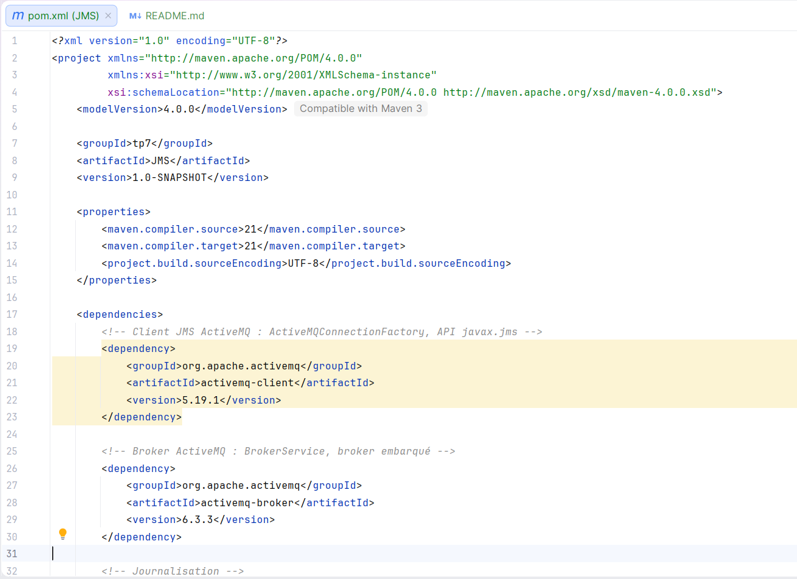
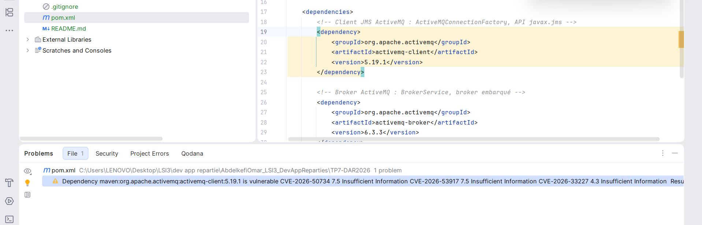
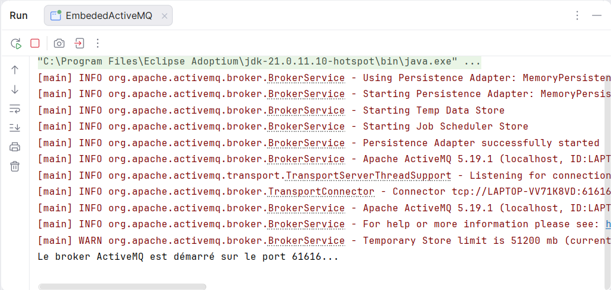
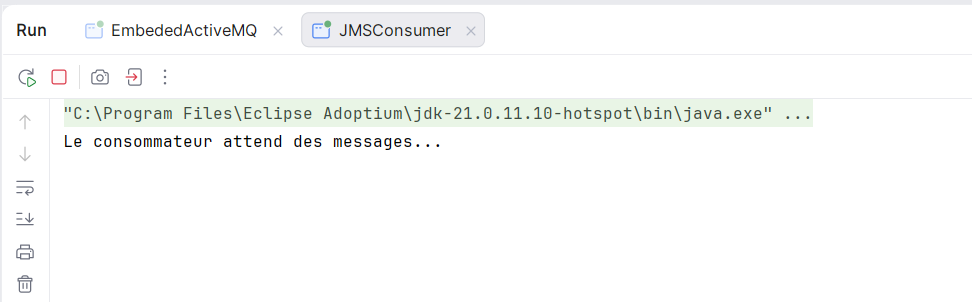
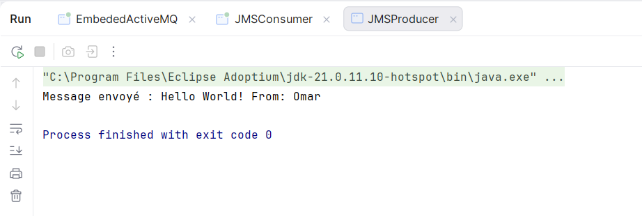
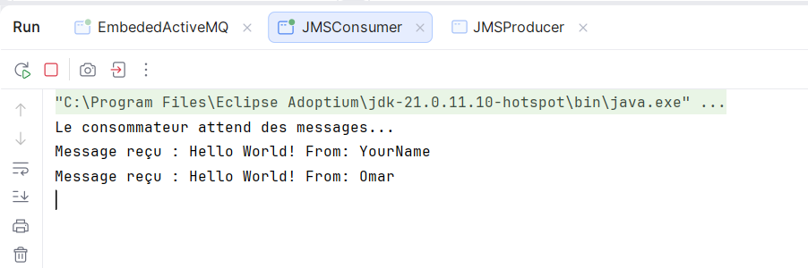

# TP7-DAR2026 - Système distribué asynchrone : JMS avec ActiveMQ

Abdelkefi Omar - LSI3

Code source : [src/main/java/jms](src/main/java/jms)

## Configuration du projet
J'ai créé un projet Maven (TP7_JMS) et ajouté les dépendances activemq-client, activemq-broker et slf4j-simple dans le fichier pom.xml. Maven télécharge automatiquement les JARs nécessaires.

## Broker embarqué
La classe EmbededActiveMQ crée un objet BrokerService, lui ajoute un connecteur TCP qui écoute sur toutes les interfaces au port 61616, puis démarre le broker avec start(). Cette classe joue le rôle de BrokerStarter demandé dans l'étape 5.

## Consommateur
JMSConsumer crée une ConnectionFactory (tcp://localhost:61616), une connexion, une session, un Topic et un MessageConsumer. Un MessageListener permet de recevoir les messages de façon asynchrone dès qu'ils sont publiés. Il est lancé avant le producteur.

## Producteur
JMSProducer envoie le message "Hello World! From: Nom Prénom" sur le Topic avec une session transactionnelle et un mode de livraison non persistant. L'envoi est validé avec session.commit().

## Résultat
Le consommateur reçoit le message envoyé par le producteur.

## Synthèse
JMS est un système asynchrone : le producteur et le consommateur ne communiquent pas directement, ils passent par le broker et ne sont pas obligés d'être actifs en même temps. Avec un Topic (publication/abonnement), le message est diffusé à tous les consommateurs abonnés au moment de l'envoi. C'est pourquoi le consommateur est lancé avant le producteur.